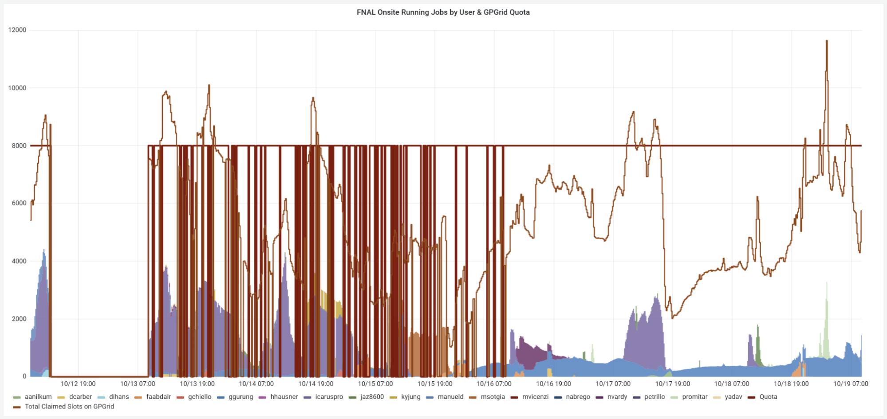
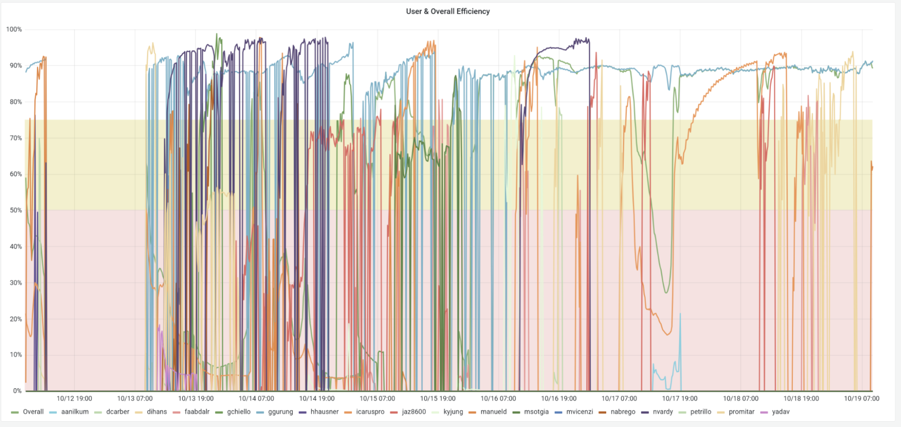
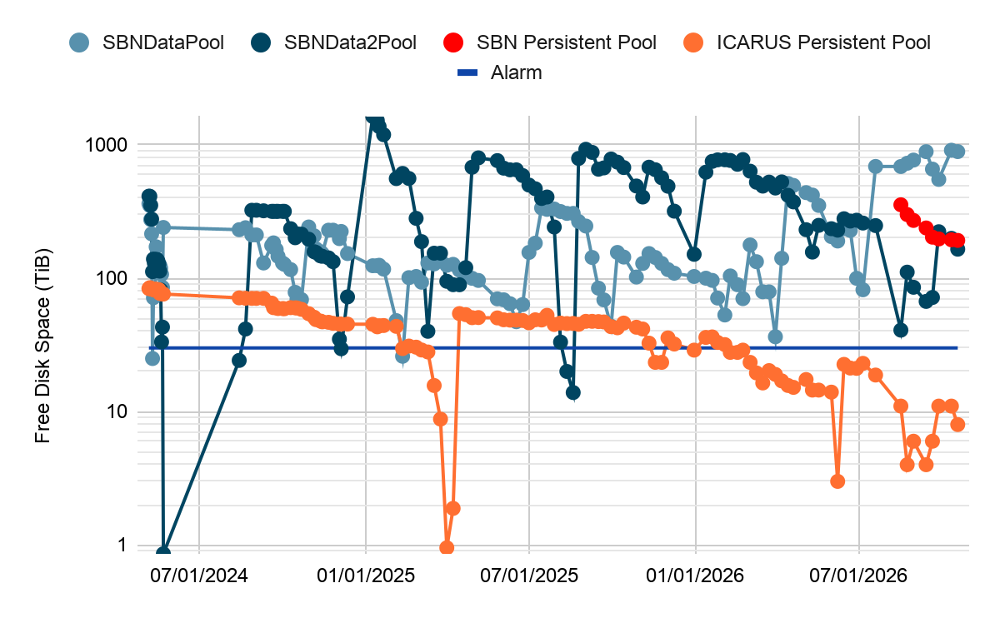
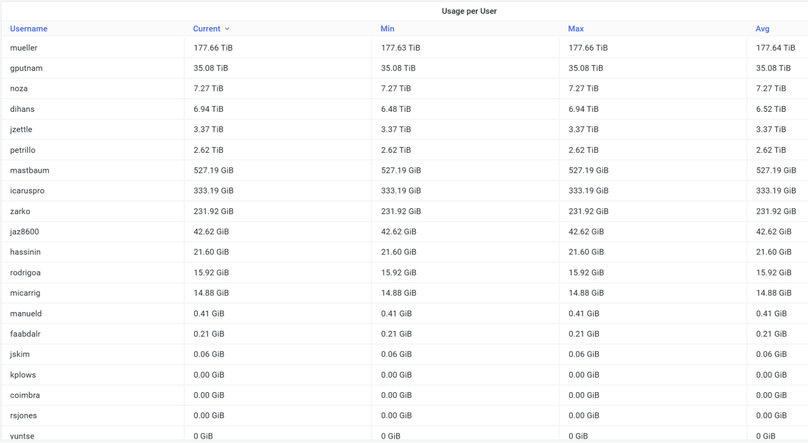
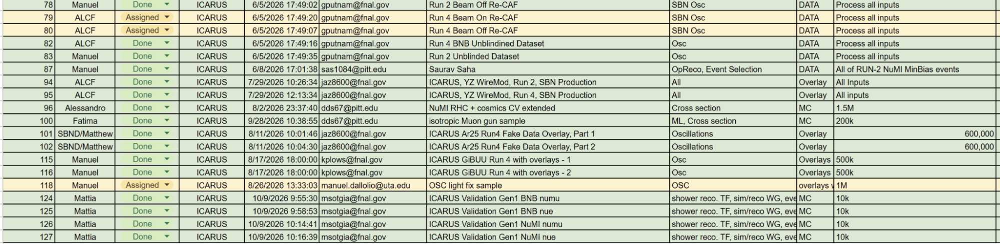

# ICARUS Data Production and Management Meeting

## ott 19, 2026 09:00 GMT-5

## Attendees

Alessandro Maria Ricci, Giuseppe Cerati, Saurav Saha, Giovanni Chiello, Matthe Siden, Manuel Dallolio, Fatima Abd Alrahman, Vito Di Benedetto, Tracy Usher

# Monitor

| User Grid UsageHistory of the Running Jobs by User for the last 7 days: [link](https://fifemon.fnal.gov/monitor/d/000000053/experiment-batch-details?orgId=1&viewPanel=9&from=now-7d&to=now&var-experiment=icarus&var-pool=dune-global&var-pool=fifebatch)  | User Job EfficiencyHistory of the User Job Efficiency for the last 7 days: [link](https://fifemon.fnal.gov/monitor/d/000000022/experiment-efficiency-details?from=now-7d&to=now&var-experiment=icarus&var-pool=dune-global&var-pool=fifebatch&orgId=1&viewPanel=2)  |
| ----- | ----- |
| **Icaruspro Jobs Exit Code**History of the icaruspro job exit code for the last 7 days: [link](https://landscape.fnal.gov/osprod/app/dashboards#/view/ba047b90-b8ca-11e7-989a-91951b87e80a?_g=\(filters:!\(\),refreshInterval:\(pause:!t,value:0\),time:\(from:now-15m,to:now\)\)&_a=\(description:'View%20jobs%20exit%20code,%20where%20they%20ran,%20and%20logs',filters:!\(\('$state':\(store:appState\),meta:\(alias:!n,disabled:!f,index:'fifebatch-history-*',key:pool,negate:!f,params:\(query:fifebatch\),type:phrase\),query:\(match:\(pool:\(query:fifebatch,type:phrase\)\)\)\),\('$state':\(store:appState\),meta:\(alias:!n,disabled:!f,index:'fifebatch-history-*',key:Owner,negate:!f,params:\(query:icaruspro\),type:phrase\),query:\(match_phrase:\(Owner:icaruspro\)\)\)\),fullScreenMode:!f,options:\(darkTheme:!f\),query:\(language:lucene,query:''\),timeRestore:!f,title:'Condor%20History',viewMode:view\)) | **SBN Data Pools**History of the SBN Data Pools: [link](https://fifemon.fnal.gov/monitor/d/rflbgV-iz/dcache-by-poolgroup?orgId=1&var-PoolGroup=SbnDataPools&from=now-3h&to=now&refresh=5m) |
|  |  |
| **ICARUS dCache Persistent Usage per User** Total is 114 TiB: [link](https://fifemon.fnal.gov/monitor/d/000000175/dcache-persistent-usage-by-vo?orgId=1&var-VO=icarus), Used space: 106 TiB (93%) |  **SBN dCache Persistent Usage per User** Total is 426 TiB: [link](https://fifemon.fnal.gov/monitor/d/000000175/dcache-persistent-usage-by-vo?orgId=1&var-VO=sbn), Used space: 234 TiB (63.7%) |
|  |  |

### 

# Data Production

| 2026 ICARUS Requests [Link](https://docs.google.com/spreadsheets/d/1ffBp475tEzlRilFs7xLhbevSZHjsuk1Dm5FGFIPWsFM/edit?gid=588919686#gid=588919686) |
| ----- |
|  |

Link to [SBN spreadsheet](https://docs.google.com/spreadsheets/d/17mFPGsP7gw4GRLSCwIL15QrtUnLVri_2k2Wjzhd6Ork/edit?gid=1971194639#gid=1971194639)  
Link to [POMS active campaigns](https://pomsgpvm02.fnal.gov/poms/show_campaigns/icarus/production)

* Link to [SBN-production-coordination](https://docs.google.com/document/d/1n-ohkPORnkhiyzEKMAlY4m1bTeovy9I1iOxQIN0lJmU/edit?tab=t.0)  
* Alessandro Create a campaign template with associated cfg.  
* Alessandro Change cfg for future campaigns:  
  * Save larcv directly on tape  
  * Mitigate the duplicates with the draining dataset: To obtain a draining dataset, you need to add SAM dimensions of the type ... and not isparentof: ( \<dimensions\> ), where \<dimensions\> can be the SAM definitions of the outputs.  
* Investigate why we have duplicates

# 

# Keepup

* Manuel Check duplicates once per week.

# 

# Data Management

Link to [action items](https://github.com/orgs/SBNSoftware/projects/32)

## FTS

* Nobody **Transfer of Run2 compressed files to Tape** **(420 TB)**  
  The tape transfer has been split by data stream, the selection was based on origin path (SBNDATA/SBNDATA2 suffix is to select files from one of SBNDataPools/SBNData2Pools):  
  * run2\_compressed\_bnbmajority\_SBNDATA \-\> DELETED   
  * run2\_compressed\_bnbmajority\_SBNDATA2 \-\> DELETED  
  * run2\_compressed\_bnbminbias\_SBNDATA \-\> DELETED  
  * run2\_compressed\_bnbminbias\_SBNDATA2 \-\> DELETED  
  * run2\_compressed\_offbeambnbmajority\_SBNDATA \-\> DELETED  
  * run2\_compressed\_offbeambnbmajority\_SBNDATA2 \-\> DELETED  
  * run2\_compressed\_offbeambnbminbias\_SBNDATA \-\> DELETED  
  * run2\_compressed\_offbeambnbminbias\_SBNDATA2 \-\> DELETED

  **Run 2 raw data have some missing files, we need to regenerate them.**

* SauravGiovanni Transfer of BNB stage1 run2 to tape:  
  * Icaruspro\_2024\_Run2\_production\_Reproc\_Run2\_v09\_89\_01\_01p03\_bnbmajority\_stage1 (90 TB) \-\> Saurav is fixing the missing metadata  
  * icaruspro\_production\_v09\_89\_01\_01\_2024A\_ICARUS\_MC\_Sys\_NuCos\_2024A\_MC\_Sys\_NuCos\_CV\_2ndV\_stage1 (51 TB):  
    * Check if the transfer is complete;  
    * Launch rm \-r on the folder containing MC stage1

  Some files remained on disk because they do not have metadata.

* Saurav Giovanni Transfer of BNB Run 2 systematics sample to tape:  
  **`/pnfs/sbn/data/sbn_fd/poms_production/2024A_ICARUS_MC_Sys_NuCos`**  
  823G 2024A\_MC\_Sys\_NuCos\_10Per\_IntNoiseDown\_2ndV  
  840G 2024A\_MC\_Sys\_NuCos\_10Per\_IntNoiseUp\_2ndV  
  863G 2024A\_MC\_Sys\_NuCos\_CathBen\_2ndV  
  684G 2024A\_MC\_Sys\_NuCos\_CathBen\_2ndV\_correct  
  825G 2024A\_MC\_Sys\_NuCos\_CollPlaneGain5Per\_2ndV  
  1021G 2024A\_MC\_Sys\_NuCos\_CV  
  58T 2024A\_MC\_Sys\_NuCos\_CV\_2ndV  
  11T 2024A\_MC\_Sys\_NuCos\_CV\_5800  
  12T 2024A\_MC\_Sys\_NuCos\_CV\_6200  
  118G 2024A\_MC\_Sys\_NuCos\_CV\_part2  
  254G 2024A\_MC\_Sys\_NuCos\_CV\_part3  
  160G 2024A\_MC\_Sys\_NuCos\_CV\_part4  
  888G 2024A\_MC\_Sys\_NuCos\_GainHi\_2ndV  
  838G 2024A\_MC\_Sys\_NuCos\_GainVar\_2ndV  
  885G 2024A\_MC\_Sys\_NuCos\_HighLT\_2ndV  
  884G 2024A\_MC\_Sys\_NuCos\_HighLT\_2ndV\_correct  
  876G 2024A\_MC\_Sys\_NuCos\_HiTPCCohNoise\_2ndV  
  871G 2024A\_MC\_Sys\_NuCos\_HiTPCNoise\_2ndV  
  877G 2024A\_MC\_Sys\_NuCos\_IndGap1WireFil\_2ndV  
  863G 2024A\_MC\_Sys\_NuCos\_LoTPCNoise\_2ndV  
  878G 2024A\_MC\_Sys\_NuCos\_LowLT\_2ndV  
  878G 2024A\_MC\_Sys\_NuCos\_LowLT\_2ndV\_correct  
  874G 2024A\_MC\_Sys\_NuCos\_LowTPCCohNoise\_2ndV  
  874G 2024A\_MC\_Sys\_NuCos\_LowTPCCohNoise\_3rdV  
  944G 2024A\_MC\_Sys\_NuCos\_NewCV\_MidIndShptime\_2ndV  
  880G 2024A\_MC\_Sys\_NuCos\_NullVar\_2ndV  
  867G 2024A\_MC\_Sys\_NuCos\_RecoMod\_2ndV  
  932G 2024A\_MC\_Sys\_NuCos\_respunCV\_2ndV  
  805G 2024A\_MC\_Sys\_NuCos\_ScintQE\_2ndV  
  87G 2024A\_MC\_Sys\_NuCos\_SigStretch\_2ndV  
  1.2T 2024A\_MC\_Sys\_NuCos\_SigStretchDown\_2ndV  
  1.3T 2024A\_MC\_Sys\_NuCos\_SigStretchUp\_2ndV  
  53G 2024A\_MC\_Sys\_NuCos\_TPCSigShp  
  44T 2024A\_MC\_Sys\_NuCos\_TPCYZsim\_3rdV

## Storage

* Matthew Investigate:  
  * /data\_stage1 TO BE DELETED  
  * /icarus\_keepup  
    * ask for calibration ntuples of run3 because we have multiple copies  
  * /mc/2025A\_ICARUS\_NuGraph2 TO BE DELETED  
  * BNB Overlay campaign: check if we can remove some versions  
  * run3 specific runs with PMT waveforms?  
* AntonioThese are the files dCache reported had file transfer issues, so the could be corrupted. Paths in the file are using the dCache namespace, so the paths need to be mapped like this /pnfs/fs/usr/ \-\> /pnfs/  
  dCache admin reported a list of files with errors while they where transferred to dCache, they are available at: /exp/icarus/data/users/vito/dCache/SBN\_ERRORFILESINDCACHE.LIST  
  2808 of them are in /pnfs/fs/usr/sbn/data, so I think these are ICARUS files,  
  2688 of them are in /pnfs/fs/usr/sbn/data/sbn\_fd/poms\_test/2025A\_NuMI\_nuCos\_CV\_detsys/nu\_cos\_CV\_scrub/mc/reconstructed/icaruscode\_v09\_89\_01\_02p02/scrub, so possibly where test files, they asked if the experiment can remove these files  
* Fatima Clean SBNData2Pool:  
  \# Move to our data pool or to tape  
  downsize\_run2\_compression\_production\_v09\_82\_02\_01\_offbeambnbminbias\_compressed\_data  
  run2\_compression\_production\_v09\_82\_02\_01\_offbeambnbminbias\_compressed\_data\_draining  
  run2\_compression\_production\_v09\_82\_02\_01\_offbeambnbminbias\_compressed\_data\_draining\_with\_limit\_20  
  run2\_compression\_production\_v09\_82\_02\_01\_offbeambnbminbias\_compressed\_data\_with\_limit\_2  
  run2\_compression\_production\_v09\_82\_02\_01\_offbeambnbminbias\_compressed\_data\_draining\_with\_limit\_40  
  run2\_compression\_production\_v09\_82\_02\_01\_offbeambnbminbias\_compressed\_data\_with\_limit\_6500\_leftover  
  run2\_compression\_production\_v09\_82\_02\_01\_offbeambnbminbias\_compressed\_data\_with\_limit\_6500  
  run2\_compression\_production\_v09\_82\_02\_01\_offbeambnbminbias\_compressed\_data\_with\_limit\_6500\_leftover\_recovery2  
  run2\_compression\_production\_v09\_82\_02\_01\_offbeambnbminbias\_compressed\_data\_limited  
  run2\_compression\_production\_v09\_82\_02\_01\_offbeambnbminbias\_compressed\_data\_limited\_leftovers  
  run2\_compression\_production\_v09\_82\_02\_01\_offbeambnbminbias\_compressed\_data\_limited\_leftovers2  
  run2\_compression\_production\_v09\_82\_02\_01\_offbeambnbminbias\_compressed\_data\_Perlmutter

  \# Move to our data pool

  globus\_dtn\_xfer\_test9\_gputnam\_run2\_compression\_production\_v09\_82\_02\_01\_offbeambnbminbias\_compressed\_data\_WireModInputsPart2\_TEST

  globus\_dtn\_xfer\_gputnam\_run2\_compression\_production\_v09\_82\_02\_01\_offbeambnbminbias\_compressed\_data\_WireModInputsPart2\_TEST

\# Already retired  
production\_mc\_2026A\_ICARUS\_Run2\_MC\_WireMod\_Var\_test\_v10\_06\_00\_12\_larcv  
production\_mc\_2026A\_ICARUS\_Run2\_MC\_WireMod\_Var\_test\_v10\_06\_00\_12\_calibtuples  
production\_mc\_2026A\_ICARUS\_Run2\_MC\_WireMod\_Var\_test\_v10\_06\_00\_12\_flatcaf  
production\_mc\_2026A\_ICARUS\_Run2\_MC\_WireMod\_Var\_test\_v10\_06\_00\_12\_caf  
production\_mc\_GIBUU\_BNB\_v9\_v10\_single\_electron\_bnb\_v10\_06\_00\_12\_caf  
test\_mc\_GIBUU\_BNB\_v9\_v10\_test\_prod\_v10\_06\_00\_12\_flatcaf  
production\_mc\_GIBUU\_BNB\_v9\_v10\_single\_electron\_bnb\_v10\_06\_00\_12\_flatcaf  
production\_mc\_GIBUU\_BNB\_v9\_v10\_test\_prod\_v10\_06\_00\_12\_flatcaf  
production\_mc\_GIBUU\_BNB\_corsika\_bnb\_v10\_06\_00\_12\_flatcaf  
production\_mc\_GIBUU\_BNB\_v9\_v10\_test\_prod\_v10\_06\_00\_12\_caf

test\_mc\_GIBUU\_BNB\_v9\_v10\_test\_prod\_v10\_06\_00\_12\_caf

*   
* Alessandro Clean icaruspro home folder (131 GB):  
  * All 2023 folders  
* ICARUS Persistent:  
  * Saurav move /pnfs/icarus/persistent/users/cfarnese/SCANNING\_Materials/. These are user files and they must be saved in the folder /pnfs/icarus/archive/sam\_managed\_users/cfarnese/ \-\> ONGOING  
  * Saurav Contact Daniel Carber asking to delete or transfer on tape the files in his folder   
  * Giuseppe Alessandro Vito Contact the users to clean ICARUS Persistent  
  * [IcarusCalibPools](https://fndca2b.fnal.gov:22880/pools/list/PoolManager//IcarusCalibPools/spaces) Investigate this storage. Maybe some calib ntuples saved in Persistent can be moved here

## Website

* PromitaFatima Update and clean the website

## CNAF

* **RUN3 Processing**:   
  **Valerio and his team:** they have processed 100% of on- and off-beam, both bnbmajority and bnbminbias. Now the Italian team is processing the Calibration. Then, stage1 and caf will be reprocessed. **CNAF is full at 99%. Calibration is ongoing.**

## Computing

* Vito:  
  * Vito increased the nodes in NERSC to 20 units, 100 just in case contacting Vito.  
  * SDumont in Brazil (LNCC): setup ongoing \-\> probably it will arrive soon