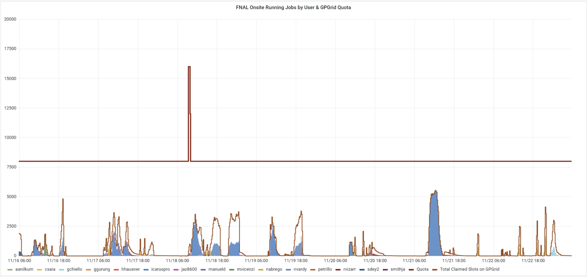
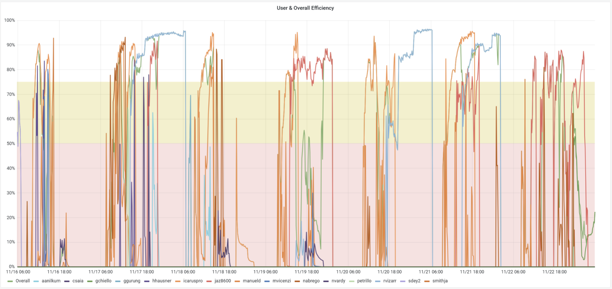
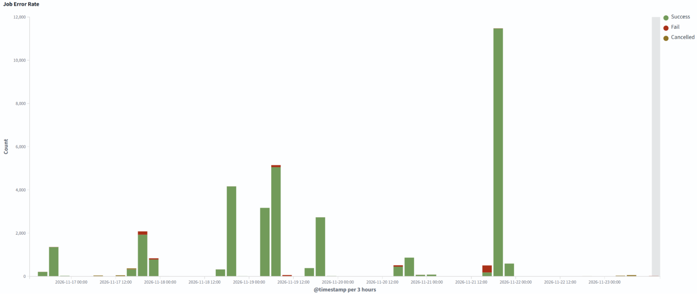
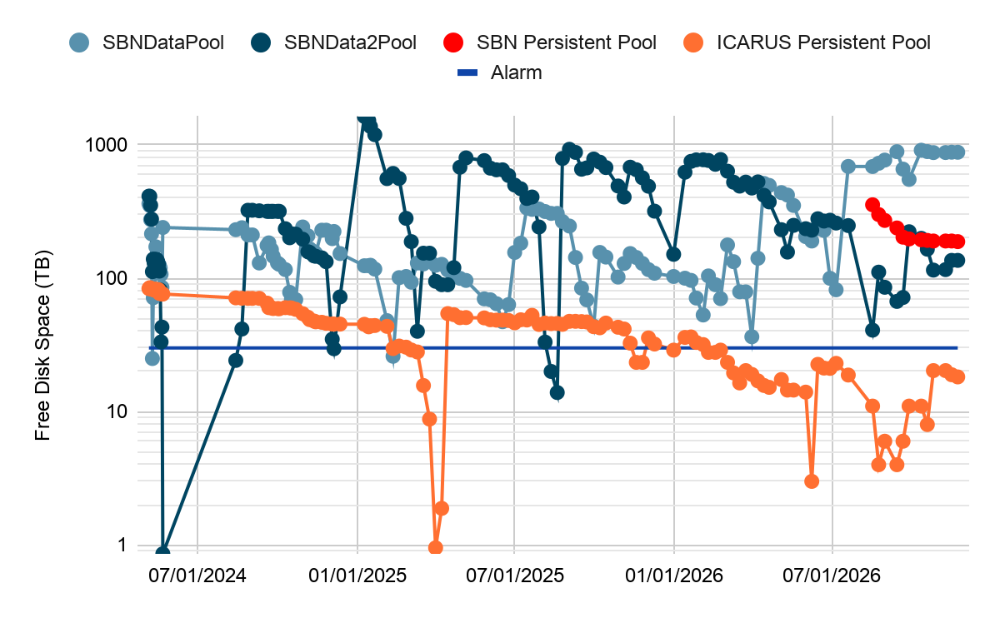
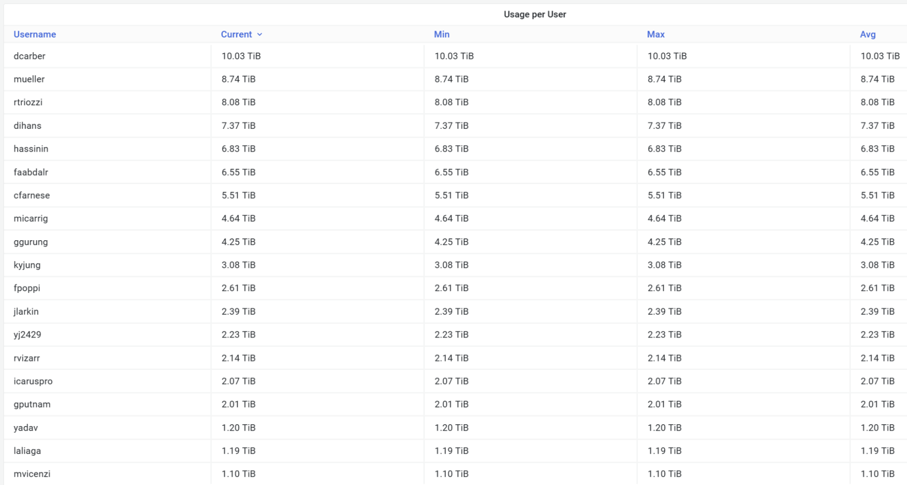
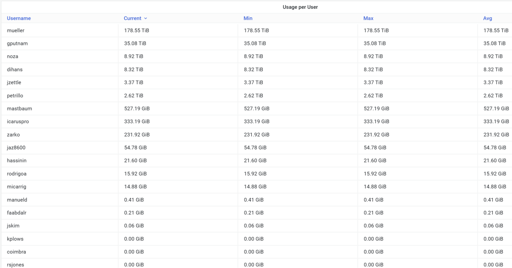
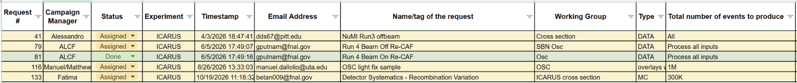

# ICARUS Data Production and Management Meeting

## nov 23, 2026 09:00 GMT-6

## Attendees

Alessandro Maria Ricci, Beatrice Bellantonio, Giuseppe Cerati, Giovanni Chiello, Tracy Usher, Manuel Dall’Olio, Vito Di Benedetto

# Monitor

| User Grid UsageHistory of the Running Jobs by User for the last 7 days: [link](https://fifemon.fnal.gov/monitor/d/000000053/experiment-batch-details?orgId=1&viewPanel=9&from=now-7d&to=now&var-experiment=icarus&var-pool=dune-global&var-pool=fifebatch)  | User Job EfficiencyHistory of the User Job Efficiency for the last 7 days: [link](https://fifemon.fnal.gov/monitor/d/000000022/experiment-efficiency-details?from=now-7d&to=now&var-experiment=icarus&var-pool=dune-global&var-pool=fifebatch&orgId=1&viewPanel=2)  |
| ----- | ----- |
| **Icaruspro Jobs Exit Code**History of the icaruspro job exit code for the last 7 days: [link](https://landscape.fnal.gov/osprod/app/dashboards#/view/ba047b90-b8ca-11e7-989a-91951b87e80a?_g=\(filters:!\(\),refreshInterval:\(pause:!t,value:0\),time:\(from:now-15m,to:now\)\)&_a=\(description:'View%20jobs%20exit%20code,%20where%20they%20ran,%20and%20logs',filters:!\(\('$state':\(store:appState\),meta:\(alias:!n,disabled:!f,index:'fifebatch-history-*',key:pool,negate:!f,params:\(query:fifebatch\),type:phrase\),query:\(match:\(pool:\(query:fifebatch,type:phrase\)\)\)\),\('$state':\(store:appState\),meta:\(alias:!n,disabled:!f,index:'fifebatch-history-*',key:Owner,negate:!f,params:\(query:icaruspro\),type:phrase\),query:\(match_phrase:\(Owner:icaruspro\)\)\)\),fullScreenMode:!f,options:\(darkTheme:!f\),query:\(language:lucene,query:''\),timeRestore:!f,title:'Condor%20History',viewMode:view\)) | **SBN Data Pools**History of the SBN Data Pools: [link](https://fifemon.fnal.gov/monitor/d/rflbgV-iz/dcache-by-poolgroup?orgId=1&var-PoolGroup=SbnDataPools&from=now-3h&to=now&refresh=5m) |
|  |  |
| **ICARUS dCache Persistent Usage per User** Total is 114 TiB: [link](https://fifemon.fnal.gov/monitor/d/000000175/dcache-persistent-usage-by-vo?orgId=1&var-VO=icarus), Used space: 95.8 TiB (83.9%) |  **SBN dCache Persistent Usage per User** Total is 426 TiB: [link](https://fifemon.fnal.gov/monitor/d/000000175/dcache-persistent-usage-by-vo?orgId=1&var-VO=sbn), Used space: 238 TiB (55.9%) |
|  |  |

### 

# Data Production

| 2026 ICARUS Requests [Link](https://docs.google.com/spreadsheets/d/1ffBp475tEzlRilFs7xLhbevSZHjsuk1Dm5FGFIPWsFM/edit?gid=588919686#gid=588919686) |
| ----- |
|  |

Link to [SBN spreadsheet](https://docs.google.com/spreadsheets/d/17mFPGsP7gw4GRLSCwIL15QrtUnLVri_2k2Wjzhd6Ork/edit?gid=1971194639#gid=1971194639)  
Link to [POMS active campaigns](https://pomsgpvm02.fnal.gov/poms/show_campaigns/icarus/production)

* Link to [SBN-production-coordination](https://docs.google.com/document/d/1n-ohkPORnkhiyzEKMAlY4m1bTeovy9I1iOxQIN0lJmU/edit?tab=t.0)  
* Alessandro Create a campaign template with associated cfg.  
* Alessandro Change cfg for future campaigns:  
  * Save larcv directly on tape  
  * SBN setup on POMS  
* Manuel Test SDumont  
* Investigate why we have duplicates

# 

# Keepup

* Manuel Check duplicates each Friday.

# 

# Data Management

Link to [action items](https://github.com/orgs/SBNSoftware/projects/32)

## FTS

* Beatrice **Transfer of Run2 compressed files to Tape** **(420 TB)**  
  The tape transfer has been split by data stream, the selection was based on origin path (SBNDATA/SBNDATA2 suffix is to select files from one of SBNDataPools/SBNData2Pools):  
  * run2\_compressed\_bnbmajority\_SBNDATA \-\> DELETED   
  * run2\_compressed\_bnbmajority\_SBNDATA2 \-\> DELETED  
  * run2\_compressed\_bnbminbias\_SBNDATA \-\> DELETED  
  * run2\_compressed\_bnbminbias\_SBNDATA2 \-\> DELETED  
  * run2\_compressed\_offbeambnbmajority\_SBNDATA \-\> DELETED  
  * run2\_compressed\_offbeambnbmajority\_SBNDATA2 \-\> DELETED  
  * run2\_compressed\_offbeambnbminbias\_SBNDATA \-\> DELETED  
  * run2\_compressed\_offbeambnbminbias\_SBNDATA2 \-\> DELETED

  **247 files of Run 2 compressed raw data are missing, we need to regenerate them.**

  **Some files wrong have data stream, we need to fix them.**

* SauravGiovanni Transfer of BNB stage1 run2 to tape:  
  * Icaruspro\_2024\_Run2\_production\_Reproc\_Run2\_v09\_89\_01\_01p03\_bnbmajority\_stage1 (90 TB) \-\> Saurav is fixing the missing metadata  
  * icaruspro\_production\_v09\_89\_01\_01\_2024A\_ICARUS\_MC\_Sys\_NuCos\_2024A\_MC\_Sys\_NuCos\_CV\_2ndV\_stage1 (51 TB):  
    * Check if the transfer is complete;  
    * Remove the old location  
    * Launch rmdir on the folder containing MC stage1

  Some files remained on disk because they do not have metadata.

* Saurav Giovanni Transfer of BNB Run 2 systematics sample to tape:  
  **`/pnfs/sbn/data/sbn_fd/poms_production/2024A_ICARUS_MC_Sys_NuCos`**  
  823G 2024A\_MC\_Sys\_NuCos\_10Per\_IntNoiseDown\_2ndV  
  840G 2024A\_MC\_Sys\_NuCos\_10Per\_IntNoiseUp\_2ndV  
  863G 2024A\_MC\_Sys\_NuCos\_CathBen\_2ndV  
  684G 2024A\_MC\_Sys\_NuCos\_CathBen\_2ndV\_correct  
  825G 2024A\_MC\_Sys\_NuCos\_CollPlaneGain5Per\_2ndV  
  1021G 2024A\_MC\_Sys\_NuCos\_CV  
  58T 2024A\_MC\_Sys\_NuCos\_CV\_2ndV  
  11T 2024A\_MC\_Sys\_NuCos\_CV\_5800  
  12T 2024A\_MC\_Sys\_NuCos\_CV\_6200  
  118G 2024A\_MC\_Sys\_NuCos\_CV\_part2  
  254G 2024A\_MC\_Sys\_NuCos\_CV\_part3  
  160G 2024A\_MC\_Sys\_NuCos\_CV\_part4  
  888G 2024A\_MC\_Sys\_NuCos\_GainHi\_2ndV  
  838G 2024A\_MC\_Sys\_NuCos\_GainVar\_2ndV  
  885G 2024A\_MC\_Sys\_NuCos\_HighLT\_2ndV  
  884G 2024A\_MC\_Sys\_NuCos\_HighLT\_2ndV\_correct  
  876G 2024A\_MC\_Sys\_NuCos\_HiTPCCohNoise\_2ndV  
  871G 2024A\_MC\_Sys\_NuCos\_HiTPCNoise\_2ndV  
  877G 2024A\_MC\_Sys\_NuCos\_IndGap1WireFil\_2ndV  
  863G 2024A\_MC\_Sys\_NuCos\_LoTPCNoise\_2ndV  
  878G 2024A\_MC\_Sys\_NuCos\_LowLT\_2ndV  
  878G 2024A\_MC\_Sys\_NuCos\_LowLT\_2ndV\_correct  
  874G 2024A\_MC\_Sys\_NuCos\_LowTPCCohNoise\_2ndV  
  874G 2024A\_MC\_Sys\_NuCos\_LowTPCCohNoise\_3rdV  
  944G 2024A\_MC\_Sys\_NuCos\_NewCV\_MidIndShptime\_2ndV  
  880G 2024A\_MC\_Sys\_NuCos\_NullVar\_2ndV  
  867G 2024A\_MC\_Sys\_NuCos\_RecoMod\_2ndV  
  932G 2024A\_MC\_Sys\_NuCos\_respunCV\_2ndV  
  805G 2024A\_MC\_Sys\_NuCos\_ScintQE\_2ndV  
  87G 2024A\_MC\_Sys\_NuCos\_SigStretch\_2ndV  
  1.2T 2024A\_MC\_Sys\_NuCos\_SigStretchDown\_2ndV  
  1.3T 2024A\_MC\_Sys\_NuCos\_SigStretchUp\_2ndV  
  53G 2024A\_MC\_Sys\_NuCos\_TPCSigShp  
  44T 2024A\_MC\_Sys\_NuCos\_TPCYZsim\_3rdV

## Storage

* Matthew Investigate:  
  * /data\_stage1 TO BE DELETED  
  * /icarus\_keepup  
    * ask for calibration ntuples of run3 because we have multiple copies  
  * /mc/2025A\_ICARUS\_NuGraph2  
    Retired:  
    production\_mc\_2025A\_ICARUS\_NuGraph2\_2DDeconvolution\_04Jun2025\_v10\_06\_00\_01p01\_caf  
    production\_mc\_2025A\_ICARUS\_NuGraph2\_2DDeconvolution\_04Jun2025\_v10\_06\_00\_01p01\_flatcaf  
    production\_mc\_2025A\_ICARUS\_NuGraph2\_2DSigProc\_16Jun2025\_v10\_06\_00\_01p01\_caf  
    production\_mc\_2025A\_ICARUS\_NuGraph2\_2DSigProc\_16Jun2025\_v10\_06\_00\_01p01\_flatcaf  
    production\_mc\_2025A\_ICARUS\_NuGraph2\_AddedNuGraph2\_NuMI\_sample\_29May2025\_v10\_06\_00\_01p01\_caf  
    production\_mc\_2025A\_ICARUS\_NuGraph2\_AddedNuGraph2\_NuMI\_sample\_29May2025\_v10\_06\_00\_01p01\_flatcaf  
    production\_mc\_2025A\_ICARUS\_NuGraph2\_BNB\_MC\_20Aug2025\_v10\_06\_00\_04p02\_caf  
    production\_mc\_2025A\_ICARUS\_NuGraph2\_BNB\_MC\_20Aug2025\_v10\_06\_00\_04p02\_flatcaf  
    production\_mc\_2025A\_ICARUS\_NuGraph2\_BNB\_MC\_25Aug2025\_v10\_06\_00\_04p02\_caf  
    production\_mc\_2025A\_ICARUS\_NuGraph2\_BNB\_MC\_25Aug2025\_v10\_06\_00\_04p02\_flatcaf  
    To be retired:  
    production\_mc\_2025A\_ICARUS\_NuGraph2\_BNB\_MC\_25Aug2025\_v10\_06\_00\_04p02\_stage1  
    production\_mc\_2025A\_ICARUS\_NuGraph2\_BNB\_sample\_10Jun2025\_v10\_06\_00\_01p01\_caf  
    production\_mc\_2025A\_ICARUS\_NuGraph2\_BNB\_sample\_10Jun2025\_v10\_06\_00\_01p01\_flatcaf  
    production\_mc\_2025A\_ICARUS\_NuGraph2\_NuGraph2Added\_v10\_NuMI\_sample\_19May2025\_v10\_06\_00\_01\_caf  
    production\_mc\_2025A\_ICARUS\_NuGraph2\_NuGraph2Added\_v10\_NuMI\_sample\_19May2025\_v10\_06\_00\_01\_flatcaf  
    production\_mc\_2025A\_ICARUS\_NuGraph2\_NuMI\_1d\_sample\_21Jul2025\_v10\_06\_00\_01p01\_caf  
    production\_mc\_2025A\_ICARUS\_NuGraph2\_NuMI\_1d\_sample\_21Jul2025\_v10\_06\_00\_01p01\_flatcaf  
    production\_mc\_2025A\_ICARUS\_NuGraph2\_NuMI\_1DSigProc\_02Jul2025\_v10\_06\_00\_01p01\_caf  
    production\_mc\_2025A\_ICARUS\_NuGraph2\_NuMI\_1DSigProc\_02Jul2025\_v10\_06\_00\_01p01\_flat  
    caf  
    production\_mc\_2025A\_ICARUS\_NuGraph2\_NuMI\_MC\_TrainingSample\_v10\_06\_00\_04p02\_caf  
    production\_mc\_2025A\_ICARUS\_NuGraph2\_NuMI\_MC\_TrainingSample\_v10\_06\_00\_04p02\_flatcaf  
    production\_mc\_2025A\_ICARUS\_NuGraph2\_NuMI\_MC\_TrainingSample\_v10\_06\_00\_04p02\_stage1  
    production\_mc\_2025A\_ICARUS\_NuGraph2\_NuMI\_MC\_TrainingSample\_v2\_v10\_06\_00\_04p02\_caf  
    production\_mc\_2025A\_ICARUS\_NuGraph2\_NuMI\_MC\_TrainingSample\_v2\_v10\_06\_00\_04p02\_flatcaf  
    production\_mc\_2025A\_ICARUS\_NuGraph2\_NuMI\_MC\_TrainingSample\_v2\_v10\_06\_00\_04p02\_stage1  
    production\_mc\_2025A\_ICARUS\_NuGraph2\_TrainingSample\_28Aug2025\_v10\_06\_00\_04p02\_caf  
    production\_mc\_2025A\_ICARUS\_NuGraph2\_TrainingSample\_28Aug2025\_v10\_06\_00\_04p02\_flatcaf  
    production\_mc\_2025A\_ICARUS\_NuGraph2\_TrainingSample\_28Aug2025\_v10\_06\_00\_04p02\_stage1  
    production\_mc\_2025A\_ICARUS\_NuGraph2\_VanillaReco\_v10\_NuMI\_sample\_v10\_06\_00\_01\_caf  
    production\_mc\_2025A\_ICARUS\_NuGraph2\_VanillaReco\_v10\_NuMI\_sample\_v10\_06\_00\_01\_flatcaf  
      
  * BNB Overlay campaign: check if we can remove some versions  
  * run3 specific runs with PMT waveforms?  
* Fatima Clean SBNData2Pool:  
  \# Move to our data pool or to tape  
  downsize\_run2\_compression\_production\_v09\_82\_02\_01\_offbeambnbminbias\_compressed\_data  
  run2\_compression\_production\_v09\_82\_02\_01\_offbeambnbminbias\_compressed\_data\_draining  
  run2\_compression\_production\_v09\_82\_02\_01\_offbeambnbminbias\_compressed\_data\_draining\_with\_limit\_20  
  run2\_compression\_production\_v09\_82\_02\_01\_offbeambnbminbias\_compressed\_data\_with\_limit\_2  
  run2\_compression\_production\_v09\_82\_02\_01\_offbeambnbminbias\_compressed\_data\_draining\_with\_limit\_40  
  run2\_compression\_production\_v09\_82\_02\_01\_offbeambnbminbias\_compressed\_data\_with\_limit\_6500\_leftover  
  run2\_compression\_production\_v09\_82\_02\_01\_offbeambnbminbias\_compressed\_data\_with\_limit\_6500  
  run2\_compression\_production\_v09\_82\_02\_01\_offbeambnbminbias\_compressed\_data\_with\_limit\_6500\_leftover\_recovery2  
  run2\_compression\_production\_v09\_82\_02\_01\_offbeambnbminbias\_compressed\_data\_limited  
  run2\_compression\_production\_v09\_82\_02\_01\_offbeambnbminbias\_compressed\_data\_limited\_leftovers  
  run2\_compression\_production\_v09\_82\_02\_01\_offbeambnbminbias\_compressed\_data\_limited\_leftovers2  
  run2\_compression\_production\_v09\_82\_02\_01\_offbeambnbminbias\_compressed\_data\_Perlmutter  
    
  \# Moved to tape  
  globus\_dtn\_xfer\_test9\_gputnam\_run2\_compression\_production\_v09\_82\_02\_01\_offbeambnbminbias\_compressed\_data\_WireModInputsPart2\_TEST  
  globus\_dtn\_xfer\_gputnam\_run2\_compression\_production\_v09\_82\_02\_01\_offbeambnbminbias\_compressed\_data\_WireModInputsPart2\_TEST

  \# Regarding SBNDATA2POOL, Fatima modified the script to report only datasets that have files physically present. Here is the list of those datasets:  
  gputnam\_DP2023G\_reprodD\_NuMIOffBeamMajorityRun1  
  gputnam\_DP2023G\_reprodD\_NuMIOffBeamMajorityRun2  
  gputnam\_DP2023G\_reprodD\_NuMIOnBeamMajorityRun1  
  gputnam\_DP2023G\_reprodD\_NuMIOnBeamMajorityRun2  
  gputnam\_DP2023G\_reprodD\_NuMIPhase2MC  
  Icaruspro\_2024\_Run3\_11813\_offbeambnbmajority\_production\_Data\_OpRecoWG\_Run3\_11813\_offbeambnbmajority\_v09\_90\_00\_offbeambnbmajority\_stage1  
  Icaruspro\_2024\_Run3\_11813\_offbeambnbminbias\_production\_Data\_OpRecoWG\_Run3\_11813\_offbeambnbminbias\_v09\_90\_00\_offbeambnbminbias\_stage1  
  Icaruspro\_2024\_Run3\_11813\_offbeamnumiminbias\_production\_Data\_OpRecoWG\_Run3\_11813\_offbeamnumiminbias\_v09\_90\_00\_offbeamnumiminbias\_stage1  
  Icaruspro\_2024\_Run3\_11813\_OpRecWG\_bnbmajority\_production\_Data\_OpRecoWG\_Run3\_11813\_bnbmajority\_v09\_90\_00\_bnbmajority\_stage1  
  Icaruspro\_2024\_Run3\_11813\_OpRecWG\_bnbminbias\_production\_Data\_OpRecoWG\_Run3\_11813\_bnbminbias\_v09\_90\_00\_bnbminbias\_stage1  
  Icaruspro\_2024\_Run3\_11813\_OpRecWG\_numimajority\_production\_Data\_OpRecoWG\_Run3\_11813\_numimajority\_v09\_90\_00\_numimajority\_stage1  
  Icaruspro\_2024\_Run3\_11813\_OpRecWG\_numiminbias\_production\_Data\_OpRecoWG\_Run3\_11813\_numiminbias\_v09\_90\_00\_numiminbias\_stage1  
  Icaruspro\_2024\_Run3\_11813\_OpRecWG\_offbeamnumimajority\_production\_Data\_OpRecoWG\_Run3\_11813\_offbeamnumimajority\_v09\_90\_00\_offbeamnumimajority\_stage1  
  Icaruspro\_2024\_Run3\_11816\_bnbmajority\_test\_Data\_Run3\_11816\_allPMT\_v09\_90\_00\_bnbmajority\_stage1  
  Icaruspro\_2024\_Run3\_11816\_offbeambnbminbias\_production\_Data\_OpRecoWG\_Run3\_11816\_offbeambnbminbias\_v09\_90\_00\_offbeambnbminbias\_stage1  
  Icaruspro\_2024\_Run3\_11816\_offbeamnumiminbias\_production\_Data\_OpRecoWG\_Run3\_11816\_offbeamnumiminbias\_v09\_90\_00\_offbeamnumiminbias\_stage1  
  Icaruspro\_2024\_Run3\_11816\_OpRecWG\_bnbmajority\_production\_Data\_OpRecoWG\_Run3\_11816\_bnbmajority\_v09\_90\_00\_bnbmajority\_stage1  
  Icaruspro\_2024\_Run3\_11816\_OpRecWG\_bnbminbias\_production\_Data\_OpRecoWG\_Run3\_11816\_bnbminbias\_v09\_90\_00\_bnbminbias\_stage1  
  Icaruspro\_2024\_Run3\_11816\_OpRecWG\_numimajority\_production\_Data\_OpRecoWG\_Run3\_11816\_numimajority\_v09\_90\_00\_numimajority\_stage1  
  Icaruspro\_2024\_Run3\_11816\_OpRecWG\_numiminbias\_production\_Data\_OpRecoWG\_Run3\_11816\_numiminbias\_v09\_90\_00\_numiminbias\_stage1  
  Icaruspro\_2024\_Run3\_11816\_OpRecWG\_offbeambnbmajority\_production\_Data\_OpRecoWG\_Run3\_11816\_offbeambnbmajority\_v09\_90\_00\_offbeambnbmajority\_stage1  
  Icaruspro\_2024\_Run3\_11816\_OpRecWG\_offbeamnumimajority\_production\_Data\_OpRecoWG\_Run3\_11816\_offbeamnumimajority\_v09\_90\_00\_offbeamnumimajority\_stage1  
  Icaruspro\_2024\_Run3\_Run11813\_OpRecWG\_bnbmajority\_production\_Data\_OpticalReconstructionWG\_Run3\_11813\_bnbmajority\_v09\_87\_00\_bnbmajority\_stage1  
  Icaruspro\_2024\_Run3\_Run11813\_OpRecWG\_bnbminbias\_production\_Data\_OpticalReconstructionWG\_Run3\_11813\_bnbminbias\_v09\_87\_00\_bnbminbias\_stage1  
  Icaruspro\_2024\_Run3\_Run11813\_OpRecWG\_numimajority\_production\_Data\_OpticalReconstructionWG\_Run3\_11813\_numimajority\_v09\_87\_00\_numimajority\_stage1  
  Icaruspro\_2024\_Run3\_Run11813\_OpRecWG\_numiminbias\_production\_Data\_OpticalReconstructionWG\_Run3\_11813\_numiminbias\_v09\_87\_00\_numiminbias\_stage1  
  Icaruspro\_2024\_Run3\_Run11813\_OpRecWG\_offbeambnbmajority\_production\_Data\_OpticalReconstructionWG\_Run3\_11813\_offbeambnbmajority\_v09\_87\_00\_offbeambnbmajority\_stage1  
  Icaruspro\_2024\_Run3\_Run11813\_OpRecWG\_offbeamnumimajority\_production\_Data\_OpticalReconstructionWG\_Run3\_11813\_offbeamnumimajority\_v09\_87\_00\_offbeamnumimajority\_stage1  
  Icaruspro\_2024\_Run3\_Run11813\_OpRecWG\_offbeamnumiminbias\_production\_Data\_OpticalReconstructionWG\_Run3\_11813\_offbeamnumiminbias\_v09\_87\_00\_offbeamnumiminbias\_stage1  
  Icaruspro\_2024\_Run3\_Run11816\_OpRecWG\_bnbmajority\_production\_Data\_OpticalReconstructionWG\_Run3\_11816\_bnbmajority\_v09\_87\_00\_bnbmajority\_stage1  
  Icaruspro\_2024\_Run3\_Run11816\_OpRecWG\_bnbminbias\_production\_Data\_OpticalReconstructionWG\_Run3\_11816\_bnbminbias\_v09\_87\_00\_bnbminbias\_stage1  
  Icaruspro\_2024\_Run3\_Run11816\_OpRecWG\_numimajority\_production\_Data\_OpticalReconstructionWG\_Run3\_11816\_numimajority\_v09\_87\_00\_numimajority\_stage1  
  Icaruspro\_2024\_Run3\_Run11816\_OpRecWG\_numiminbias\_production\_Data\_OpticalReconstructionWG\_Run3\_11816\_numiminbias\_v09\_87\_00\_numiminbias\_stage1  
  Icaruspro\_2024\_Run3\_Run11816\_OpRecWG\_offbeambnbmajority\_production\_Data\_OpticalReconstructionWG\_Run3\_11816\_offbeambnbmajority\_v09\_87\_00\_offbeambnbmajority\_stage1  
  Icaruspro\_2024\_Run3\_Run11816\_OpRecWG\_offbeamnumimajority\_production\_Data\_OpticalReconstructionWG\_Run3\_11816\_offbeamnumimajority\_v09\_87\_00\_offbeamnumimajority\_stage1  
  Icaruspro\_2024\_Run3\_Run11816\_OpRecWG\_offbeamnumiminbias\_production\_Data\_OpticalReconstructionWG\_Run3\_11816\_offbeamnumiminbias\_v09\_87\_00\_offbeamnumiminbias\_stage1  
  icaruspro\_production\_v09\_89\_01\_02p01\_2024A\_ICARUS\_MC\_Sys\_NuCos\_2024A\_MC\_Sys\_NuCos\_respunCV\_2ndV\_haddedFlatcaf  
  poms\_depends\_1648056\_1  
  poms\_depends\_1681067\_1  
  production\_mc\_2025A\_ICARUS\_BNB\_InTime\_Cosmics\_MC\_JustCafs\_FromStage1Def\_v09\_89\_01\_01p03\_haddedFlatcafs  
  run2\_compression\_production\_v09\_82\_02\_01\_offbeambnbmajority\_compressed\_data  
  TPCSignalTaskforce\_DecemberWorkshopSample\_production\_v09\_72\_00\_06\_bnbmajority\_caf\_blind  
  TPCSignalTaskforce\_DecemberWorkshopSample\_production\_v09\_72\_00\_06\_bnbmajority\_caf\_prescaled  
  TPCSignalTaskforce\_DecemberWorkshopSample\_production\_v09\_72\_00\_06\_bnbmajority\_caf\_unblind  
  TPCSignalTaskforce\_DecemberWorkshopSample\_production\_v09\_72\_00\_06\_bnbmajority\_calibtuples  
  TPCSignalTaskforce\_DecemberWorkshopSample\_production\_v09\_72\_00\_06\_bnbmajority\_flatcaf\_blind  
  TPCSignalTaskforce\_DecemberWorkshopSample\_production\_v09\_72\_00\_06\_bnbmajority\_flatcaf\_prescaled  
  TPCSignalTaskforce\_DecemberWorkshopSample\_production\_v09\_72\_00\_06\_bnbmajority\_flatcaf\_unblind  
  TPCSignalTaskforce\_DecemberWorkshopSample\_production\_v09\_72\_00\_06\_bnbmajority\_larcv  
  TPCSignalTaskforce\_DecemberWorkshopSample\_production\_v09\_72\_00\_06\_bnbmajority\_online\_purity\_histos  
  TPCSignalTaskforce\_DecemberWorkshopSample\_production\_v09\_72\_00\_06\_bnbmajority\_stage1  
  validation\_production\_TPCSignalProcessing\_v09\_78\_04\_01\_bnbmajority\_caf\_blind  
  validation\_production\_TPCSignalProcessing\_v09\_78\_04\_01\_bnbmajority\_caf\_prescaled  
  validation\_production\_TPCSignalProcessing\_v09\_78\_04\_01\_bnbmajority\_caf\_unblind  
  validation\_production\_TPCSignalProcessing\_v09\_78\_04\_01\_bnbmajority\_calibtuples  
  validation\_production\_TPCSignalProcessing\_v09\_78\_04\_01\_bnbmajority\_flatcaf\_blind  
  validation\_production\_TPCSignalProcessing\_v09\_78\_04\_01\_bnbmajority\_flatcaf\_prescaled  
  validation\_production\_TPCSignalProcessing\_v09\_78\_04\_01\_bnbmajority\_flatcaf\_unblind  
  validation\_production\_TPCSignalProcessing\_v09\_78\_04\_01\_bnbmajority\_larcv  
  validation\_production\_TPCSignalProcessing\_v09\_78\_04\_01\_bnbmajority\_stage1  
  validation\_TPCSignalProcessing\_v09\_78\_04\_01\_bnbmajority\_online\_purity\_histos  
    
* Beatrice Clean icaruspro folders:  
  * Home (77 GB)  
  * Persistent (2 TB)   
* ICARUS Persistent:  
  * Saurav Giovanni move /pnfs/icarus/persistent/users/cfarnese/SCANNING\_Materials/. These are user files and they must be saved in the folder /pnfs/icarus/archive/sam\_managed\_users/cfarnese/ \-\> ONGOING  
  * Saurav Contact Daniel Carber asking to delete or transfer on tape the files in his folder   
  * Giuseppe Alessandro Vito Contact the users to clean ICARUS Persistent  
  * [IcarusCalibPools](https://fndca2b.fnal.gov:22880/pools/list/PoolManager//IcarusCalibPools/spaces) Investigate this storage. Maybe some calib ntuples saved in Persistent can be moved here

## Website

* Fatima Update and clean the website.

## CNAF

* **RUN3 Processing**:   
  **Valerio and his team:** they have processed 100% of on- and off-beam, both bnbmajority and bnbminbias. Now the Italian team is processing the Calibration. Then, stage1 and caf will be reprocessed. **CNAF is full at 99%. Calibration is ongoing.**

## Computing

* Vito: Check the new configuration file to be used for future campaigns.